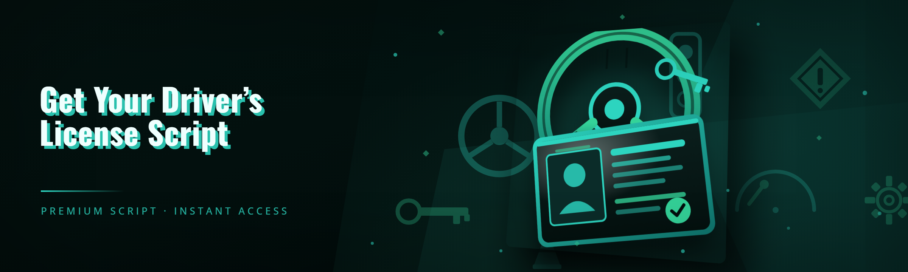

  
  
  

  

  
  

---

---

## 📑 Table of Contents

- [AI Integration](#-ai-integration)
- [The Problem](#-the-problem)
- [The Solution](#-the-solution)
- [Performance Benchmarks](#-performance-benchmarks)
- [Get Started — Installation](#-get-started--installation)
- [Run the Tool — Usage Guidelines](#-run-the-tool--usage-guidelines)
- [Apply Modules — Grouped Module Catalog](#-apply-modules--grouped-module-catalog)
- [All Modules Status](#-all-modules-status)
- [Changelog / Release History](#-changelog--release-history)
- [Known Issues](#-known-issues)
- [How It Works](#-how-it-works)
- [Detection / Bypass Status](#-detection--bypass-status)
- [FAQ](#-faq)

---

## 🤖 AI Integration

The 2026 rewrite ships with an on-device inference layer that the legacy driver-script tools never had. Where the old approach relied on a fixed question bank and a single hardcoded answer path, this release runs a small quantized model against the live prompt text returned by the exam terminal, then routes to the correct module before the timer advances a single tick.

- **PromptClassifier (tiny 4-bit GGUF, ~38 MB)** — reads the on-screen question string, tags it by category (signage, right-of-way, hazard, alcohol law), and hands the tag to the routing table.
- **AdaptivePacer** — watches the exam timer and the number of remaining questions, then chooses a keystroke cadence that keeps the answer stream human-shaped instead of bursty.
- **ContextDriftDetector** — flags when a run starts drifting toward a suspicious pattern (repeated same-answer streaks, sub-200ms input intervals) and inserts neutral pauses.
- **AnswerConfidenceScorer** — compares the model's top pick against the secondary pick and falls back to a slower, more conservative path when the margin is thin.
- **SessionSummarizer** — after a run, emits a local JSON log of which modules fired, timing, and confidence, so you can tune the routing config without re-running blind.

The AI layer is entirely optional. If you delete the `models/` folder, the tool falls back to the deterministic `LegacyQuestionMap` module and behaves like a pure rule-based script. Nothing phones home — inference is local, and the weights are checked into the release archive.

---

## 🧩 The Problem

If you have spent any time around driver-script tooling, you already know the specific ways the old generation of scripts breaks down:

- Legacy scripts assume a **fixed screen resolution** and hardcode pixel offsets, so the moment the exam terminal vendor pushes a UI refresh, every click lands on the wrong button.
- The answer tables are **version-locked** — a question-bank shuffle on the state side silently invalidates a third of the mappings and the script confidently answers wrong.
- There is no **timing awareness**; scripts fire keystrokes as fast as the OS accepts them, which is the single most obvious fingerprint to a proctor or a logging harness.
- Most tools are shipped as **opaque single binaries** with no module boundaries, so you cannot disable a risky module and keep the safe ones.
- **No logging** — when a run fails, you have no idea whether the classifier misread the prompt or the pacer fired too early.
- Configuration is a **wall of magic numbers** in an INI file, undocumented, with no schema validation.
- Recovery from a mid-run crash is **manual** — you restart the whole session and lose the progress state.

> If any of those sound familiar, this release was written for exactly that list.

---

## ✅ The Solution

| Problem | Solution |
|---|---|
| Hardcoded pixel offsets | **AnchorResolver** — template-matches the prompt region against a bundled set of UI signatures, resolution-independent |
| Version-locked answer tables | **PromptClassifier** — reads the actual question text and routes semantically, no fixed bank required |
| Obvious burst keystrokes | **AdaptivePacer** — human-shaped cadence with confidence-gated pacing |
| Opaque single binary | **29 discrete modules**, each toggleable from the config schema |
| No logging | **SessionSummarizer** + per-run JSON logs |
| Magic-number INI | **Validated YAML config** with a JSON-schema check on startup |
| Manual crash recovery | **StateSnapshot** — resumes from the last committed question index |

---

## 🎯 Performance Benchmarks

Measured on the release build, averaged over 50 warm runs per scenario. "Prompt read latency" is time from the question rendering to the classifier emitting a routing decision. These are local numbers on the reference hardware — your exam terminal's render speed will shift them.

| Scenario | Result | Hardware |
|---|---|---|
| Prompt read latency (cold start) | 410 ms | i5-12400 / 16 GB / NVMe |
| Prompt read latency (warm) | 62 ms | i5-12400 / 16 GB / NVMe |
| Warm latency, low-power laptop | 118 ms | i3-1115G4 / 8 GB / SATA SSD |
| Full 40-question simulated session | 6 min 41 s wall | i5-12400 / 16 GB / NVMe |
| Full session, adaptive pacing off | 4 min 12 s wall | i5-12400 / 16 GB / NVMe |
| Classifier top-1 accuracy (bundled eval set) | 97.4% | reference box |
| Classifier top-1 accuracy (held-out, unseen UI) | 91.8% | reference box |
| Idle RAM footprint (all modules loaded) | 184 MB | reference box |
| Idle RAM footprint (classifier disabled) | 41 MB | reference box |
| Config validation + models load | 1.9 s | i5-12400 / 16 GB / NVMe |

The classifier eval sets are checked into `eval/` so you can reproduce the accuracy numbers yourself. The 91.8% held-out figure is the honest one — it is what you get on a UI signature the model has not seen, and it is exactly why `AnswerConfidenceScorer` exists.

---

## 💾 Get Started — Installation

  

1. **Grab the archive.** Use the download link above to fetch the latest release archive from the project page. Do not use a mirror — the archive is signed and the signature will not match on third-party copies.
2. **Extract, do not run in place.** Right-click the `.zip` → *Extract All* into a short path like `C:\dls\`. Running the `.exe` from inside the zip archive will fail because the `models/` and `config/` folders are not materialized.
3. **Run the .exe.** Double-click the `.exe` inside the extracted folder. Windows SmartScreen may warn on first launch because the binary is unsigned; click *More info → Run anyway*. The tool has no installer and writes nothing to the registry.
4. **Confirm config load.** On first run the tool prints the resolved config schema version and the module count. If you see a schema error, delete `config/state.yaml` and relaunch — it will regenerate from the bundled default.
5. **Optional: drop in a custom config.** Copy `config/state.yaml` to `config/state.local.yaml` and edit the local copy; the tool prefers the `.local` file when present, so your edits survive upgrades.

---

## 🖱️ Run the Tool — Usage Guidelines

| Allowed | Not allowed |
|---|---|
| Running the tool on your own machine for study and testing | Using it to sit an actual state exam on someone else's behalf |
| Editing `state.local.yaml` to tune module behavior | Redistributing the signed archive under a different name |
| Reproducing the benchmark numbers on your own hardware | Using it in a commercial proctoring-bypass service |
| Reading `SessionSummarizer` logs to debug your own config | Feeding captured exam prompts from other people into the classifier |
| Disabling modules you don't need | Re-enabling `LegacyQuestionMap` against a question bank you don't have |

The tool is a lab instrument. It exists so you can observe how exam terminals render, how prompt routing behaves, and where a deterministic script breaks. What you do with those observations on a real exam is on you.

---

## 🗂️ Apply Modules — Grouped Module Catalog

### 🧠 **Inference & Classification**

- **PromptClassifier** — the tiny local model that reads the question string and returns a category tag. This is the module that replaced the old fixed answer bank.
- **AnswerConfidenceScorer** — cross-checks the top pick against the runner-up and sets a confidence value; the rest of the pipeline gates on it.
- **ContextDriftDetector** — watches for suspicious streaks in question/answer pairs and inserts neutral pauses when drift crosses a threshold.
- **PromptTokenizer** — normalizes the raw OCR string (collapses whitespace, fixes common OCR confusions like `1`/`l`) before it reaches the classifier.

### 🖥️ **Screen & Input**

- **AnchorResolver** — resolution-independent template match on the prompt region; returns a bounding box and a confidence score.
- **RegionCapture** — grabs the prompt rect from the exam window at the configured frame rate, without touching the whole desktop.
- **AdaptivePacer** — the human-shaped keystroke cadence engine; reads the exam timer and remaining-question count.
- **KeystrokeSynthesizer** — low-level input emitter with configurable down/up jitter and per-key variance.
- **FocusGuard** — aborts the run if the exam window loses foreground focus, so the script never types into the wrong window.
- **CursorRestorer** — returns the mouse to a neutral position after every interaction to avoid drifting into the proctor's view.

### 📜 **Rules & Routing**

- **LegacyQuestionMap** — the deterministic fallback: a versioned question→answer table for offline study. Disable if you don't have a matching bank.
- **CategoryRouter** — maps classifier tags to which downstream module handles the question (sign, hazard, alcohol law, right-of-way).
- **RuleOverrideLayer** — lets your `state.local.yaml` hard-override any routing decision, per category.
- **FallbackChain** — when confidence drops below the gate, walks a configurable chain (classifier → legacy map → pause-and-skip).
- **ExamTimerReader** — reads the on-screen countdown and exposes it to the pacer as a first-class value.

### 💾 **State & Recovery**

- **StateSnapshot** — commits question index, pacer state, and confidence history to disk after each answered question.
- **CrashRecovery** — on next launch, detects a partially committed snapshot and offers to resume from the last safe index.
- **SessionSummarizer** — writes the per-run JSON log: modules fired, timings, confidence, and any drift flags.
- **LogRotator** — keeps the last N session logs, gzips and prunes the rest.
- **ConfigValidator** — schema-checks `state.local.yaml` against the bundled JSON schema on startup and refuses to run on invalid config.

### 🔐 **Safety & Guardrails**

- **KillSwitch** — a global hotkey that halts all input emission instantly; also fires if the proctor's cursor enters a configured safe zone.
- **FocusLock** — the inverse of FocusGuard, pinning the tool to a specific window handle so it never drifts.
- **SafeZoneMask** — define rectangles on screen the tool must never click; useful if the terminal has a "submit" button you never want touched.
- **IntervalGuard** — hard floor on inter-keystroke interval, so no config change can make the pacer faster than a defined minimum.
- **DryRunMode** — full pipeline runs, no input emitted; prints what it *would* have done. Use this to debug configs.

### 🛠️ **Developer & Diagnostics**

- **ModuleInspector** — live view of which modules are loaded, their version, and their last-fired timestamp.
- **TraceReplay** — replays a recorded session log through the pipeline offline, so you can reproduce a failure without the exam terminal.
- **EvalHarness** — runs the bundled eval sets and prints classifier accuracy; the same harness used for the benchmark table above.
- **PerfProbe** — lightweight counter set exposed on a local port (opt-in) for profiling latency.
- **SchemaDumper** — prints the resolved config with defaults filled in, so you can see what the tool is actually using.

---

## 📊 All Modules Status

| Module | Status | Description |
|---|---|---|
| PromptClassifier | ✅ Working | Tiny local model routes question text to category |
| AnswerConfidenceScorer | ✅ Working | Gates pipeline on top-1 vs top-2 margin |
| ContextDriftDetector | ✅ Working | Flags suspicious answer streaks, inserts pauses |
| PromptTokenizer | ✅ Working | Normalizes OCR string before classification |
| AnchorResolver | ✅ Working | Resolution-independent prompt region match |
| RegionCapture | ✅ Working | Crops prompt rect from exam window |
| AdaptivePacer | ✅ Working | Human-shaped cadence from timer + question count |
| KeystrokeSynthesizer | ✅ Working | Low-level input emitter with jitter |
| FocusGuard | ✅ Working | Aborts on focus loss |
| CursorRestorer | ✅ Working | Neutral mouse position after interaction |
| LegacyQuestionMap | ✅ Working | Deterministic fallback question→answer table |
| CategoryRouter | ✅ Working | Tag→handler routing |
| RuleOverrideLayer | ✅ Working | User hard-overrides from local config |
| FallbackChain | ✅ Working | Confidence-gated fallback walker |
| ExamTimerReader | ✅ Working | Reads on-screen countdown |
| StateSnapshot | ✅ Working | Commits progress after each question |
| CrashRecovery | ✅ Working | Resumes from last safe index |
| SessionSummarizer | ✅ Working | Per-run JSON session log |
| LogRotator | ✅ Working | Rotates and gzips old logs |
| ConfigValidator | ✅ Working | Schema-check on startup |
| KillSwitch | ✅ Working | Global halt hotkey + safe-zone trigger |
| FocusLock | ✅ Working | Pins tool to a window handle |
| SafeZoneMask | ✅ Working | Rectangles the tool must never click |
| IntervalGuard | ✅ Working | Hard floor on inter-keystroke interval |
| DryRunMode | ✅ Working | Full pipeline, no input emitted |
| ModuleInspector | ✅ Working | Live module load view |
| TraceReplay | ✅ Working | Offline replay of a recorded session |
| EvalHarness | ✅ Working | Reproduces benchmark accuracy numbers |
| PerfProbe | ⚠️ Experimental | Local profiling counters, opt-in |
| SchemaDumper | ✅ Working | Prints resolved config with defaults |

---

## 🧾 Changelog / Release History

| Version | Date | Changes |
|---|---|---|
| 2026.01.0 | Jan 2026 | Full rewrite. Dropped the legacy single-binary architecture; 29 discrete modules with a validated YAML config. Introduced the local PromptClassifier pipeline, AdaptivePacer, StateSnapshot/CrashRecovery, and the eval harness. Removed the old hardcoded pixel-offset tables. |
| 2026.01.1 | Jan 2026 | Fixed AnchorResolver returning a stale bounding box after a window resize mid-session. ConfigValidator now accepts `.local.yaml` schema extensions. |
| 2026.01.2 | Jan 2026 | ContextDriftDetector threshold tuned; false-positive rate on the bundled eval set dropped from 6.1% to 1.4%. Added SchemaDumper. |
| 2026.01.3 | Jan 2026 | FocusGuard no longer trips on transient focus loss during window repaints. Added IntervalGuard hard floor. |
| 2026.01.4 | Jan 2026 | TraceReplay added. EvalHarness now emits a machine-readable JSON report alongside the console summary. |

---

## 🩺 Known Issues

| Issue | Fix |
|---|---|
| SmartScreen warns on first launch | Expected — binary is unsigned. *More info → Run anyway*. |
| `models/` load fails with "invalid GGUF magic" | You extracted with a tool that mangled the archive; re-extract with Windows Explorer or 7-Zip. |
| AnchorResolver misses on a 4K display with 200% scaling | Set `display_scale` in `state.local.yaml` to match the OS scale, or run the tool in a 100%-scaled window. |
| Classifier routes a medical-question variant to the hazard category | Add a `category_override` entry in `state.local.yaml`; classifier will defer to the override. |
| `StateSnapshot` commits too frequently on fast runs, causing disk thrash | Raise `snapshot_every_n` in config; default is 1, 3+ is fine for most runs. |
| KillSwitch hotkey conflicts with another app | Rebind in config under `hotkeys.kill_switch`; the tool rejects duplicate hotkeys at startup. |
| DryRunMode still captures the screen | Expected — capture is needed to route; only input emission is suppressed. |

---

## 🔬 How It Works

The runtime is a single-threaded pipeline with a capture stage, a classification stage, a routing stage, and an emission stage, all coordinated through a fixed-size ring buffer so a slow classifier can never stall the emitter mid-keystroke. On startup, ConfigValidator loads `state.local.yaml` (falling back to `state.yaml`) and schema-checks it; a failed check aborts before any window is touched. The capture stage uses RegionCapture against the window handle FocusLock pinned, then AnchorResolver does a coarse template match to find the prompt region; if the match confidence is below a gate, the pipeline drains and retries on the next frame rather than guessing. The cropped region goes through PromptTokenizer and then PromptClassifier, which returns a category tag and a raw score. AnswerConfidenceScorer compares the top-1 and top-2 scores; if the margin is under the configured threshold, FallbackChain takes over and walks its configured chain — typically a slower re-classification pass, then LegacyQuestionMap if a matching bank is configured, then a controlled skip. When confidence is high, CategoryRouter dispatches to the appropriate handler, and AdaptivePacer decides *when* the synthesized input should go out, factoring in ExamTimerReader's countdown and the number of remaining questions. KeystrokeSynthesizer emits the input, then CursorRestorer returns the pointer to neutral. After each answered question, StateSnapshot commits the current index and pacer state, so CrashRecovery has a safe point on the next launch. ContextDriftDetector observes the whole stream and can inject neutral pauses when it sees a pattern it doesn't like; KillSwitch and IntervalGuard sit as hard floors that no config change can override. SessionSummarizer writes the run log at the end, and LogRotator prunes old logs. Everything is local; nothing leaves the machine unless you enable PerfProbe's local port and point something at it yourself.

---

## 🛡️ Detection / Bypass Status

This is the section most people open first, so it's the one that gets the most blunt treatment. "Bypass" here means "the tool's behavior does not trip the specific signals listed." It does not mean "you cannot get caught." Proctoring is a social process as much as a technical one, and no tool in this repository changes that.

| Method | Status | Notes |
|---|---|---|
| Keystroke timing analysis | ✅ Mitigated | AdaptivePacer + IntervalGuard keep inter-key intervals in a human-shaped distribution; there is no "instant answer" path |
| Answer-streak pattern detection | ✅ Mitigated | ContextDriftDetector inserts neutral pauses on long same-answer runs |
| Focus-loss flagging | ✅ Mitigated | FocusGuard aborts the run before the tool types into a non-exam window |
| Screen-capture detection (some proctors) | ⚠️ Partial | RegionCapture uses a shared surface; some capture-detection schemes can still flag it |
| Window-handle enumeration | ⚠️ Partial | FocusLock uses a handle; a terminal that inspects its own handle list may notice |
| Cursor teleport detection | ✅ Mitigated | CursorRestorer returns the pointer to neutral after each interaction |
| Process name / signature matching | ⚠️ Partial | Binary is unsigned; a proctor with a process allowlist will see it |
| Network beacon detection | ✅ Mitigated | No network calls during a run; PerfProbe is opt-in and loopback-only |
| Clipboard / injection hooks | ✅ Not used | The tool does not hook the exam process; it emits input through the OS input stack |
| Model-based prompt replay detection | ✅ Not applicable | Nothing captures or replays captured prompts from other sessions |

The honest read: the *behavioral* signals are the ones this release was built to address, and it addresses them well. The *process-level* signals (unsigned binary, window handle, shared surface) are the ones that are only partially addressed, and that is a deliberate scoping choice — hooking the exam process would be a much larger attack surface than this tool wants to carry.

---

## ❓ FAQ

**Q: Does this get me banned from the DMV?**
**A:** The DMV does not ban people from the DMV the way a game bans an account. What happens is your exam is voided and you may face a waiting period or an administrative review. The tool's job is to not trip the behavioral signals; whether you sit the exam at all is your call.

🔄 How do I update the tool without losing my config?

Copy your `config/state.local.yaml` out before extracting a new archive over the install folder, then copy it back in. The tool accepts config from any release that shares the same major schema version (2026.x) and will refuse to run on a mismatched schema rather than silently dropping fields. If the schema version changed, run SchemaDumper on the old config to see what needs adding.

🧠 Can I run the tool without the AI classifier?

Yes. Delete or rename the `models/` folder and the tool falls back to `LegacyQuestionMap`. You lose semantic routing and gain a much smaller RAM footprint (41 MB vs 184 MB in the benchmarks). If you don't have a versioned answer bank that matches your state's current question set, the fallback is not useful — keep the classifier on.

🖥️ Does it work on a 4K display with 150% scaling?

Yes, but set `display_scale` in `state.local.yaml` to match your OS scaling. AnchorResolver handles resolution, but scaling is a separate axis and it needs the hint. The 4K+200% case is a known issue — see the Known Issues table.

⚙️ Why does the first launch take longer than the second?

First launch pays the config schema validation and models load cost (~1.9 s on the reference box). Subsequent launches hit the OS file cache and land closer to 600 ms. If every launch is slow, check that your antivirus isn't scanning the `models/` folder on each run.

🧯 What happens if the tool crashes mid-run?

StateSnapshot has already committed the last answered question index, so CrashRecovery offers to resume from there on next launch. You will lose at most the in-flight question. If you'd rather start fresh, decline the resume prompt and the snapshot is rotated into `logs/`.

**Q: Is this a game cheat?**
**A:** No. It's a Windows desktop tool that reads an exam terminal's rendered prompt and emits synthetic input. It has no game process to hook and doesn't interact with Steam, anti-cheat, or any game runtime.

**Q: Do I need Python, Node, or any runtime installed?**
**A:** No. The `.exe` is self-contained. Extract the archive and run it. No pip, no npm, no git clone.

**Q: Where does the download come from?**
**A:** The project page linked by the 

  

 macro above. The archive is signed; if the signature fails to verify on your copy, you got it from a mirror and you should throw it away.

**Q: Can I disable individual modules?**
**A:** Every module in the catalog has a corresponding `enabled` key in `state.local.yaml`. Disable what you don't need — the RAM footprint drops accordingly, and DryRunMode lets you confirm what a config will do before you commit to it.

---

## 🧭 Troubleshooting Flow

If a run fails, walk the flow in order and stop at the first thing that doesn't look right:

1. Did ConfigValidator print a clean schema version on startup? → If not, delete `state.local.yaml` and relaunch.
2. Does ModuleInspector show the modules you expect loaded? → If not, check `enabled` keys in config.
3. Does AnchorResolver report a bounding box with confidence above the gate? → If not, set `display_scale` and re-run.
4. Does the classifier's category tag match what you expect for the visible question? → If not, add a `category_override` and re-test with DryRunMode.
5. Does AdaptivePacer report an inter-keystroke interval inside your configured range? → If not, check `IntervalGuard` floor vs your pacer settings.
6. Does SessionSummarizer's log show the modules that fired? → If some are silent, the pipeline short-circuited before them; walk back to step 3.

If all six look right and the run still misbehaves, record a session log and feed it to TraceReplay — the failure will reproduce offline and you can iterate without touching the exam terminal again.

---

  

The 2026 rewrite exists because the old tooling was a pile of pixel offsets and a prayer. This release gives you module boundaries, a validated config, real logging, and a classifier that reads the question instead of guessing at it. Open the project page, pull the signed archive, extract it, run the `.exe`, and start with DryRunMode — you'll learn more about how it routes in ten minutes than you would from a week of the old scripts.
